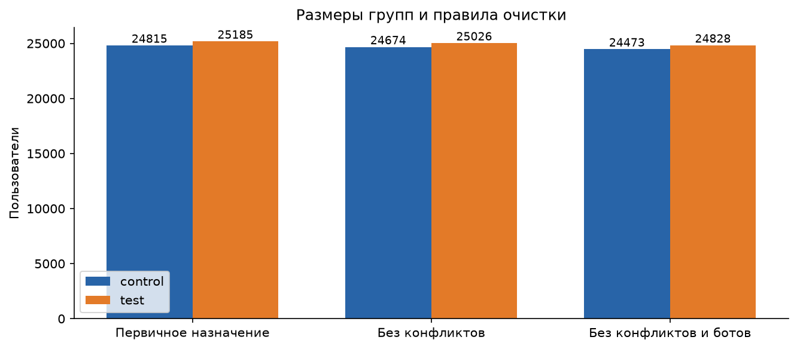
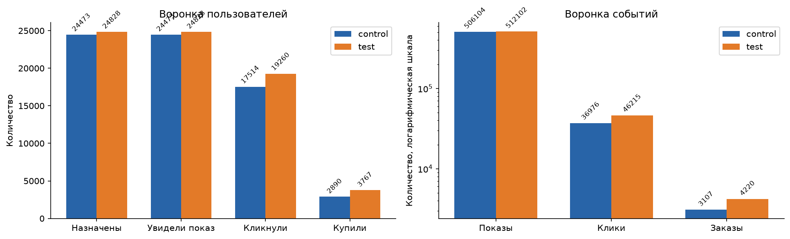
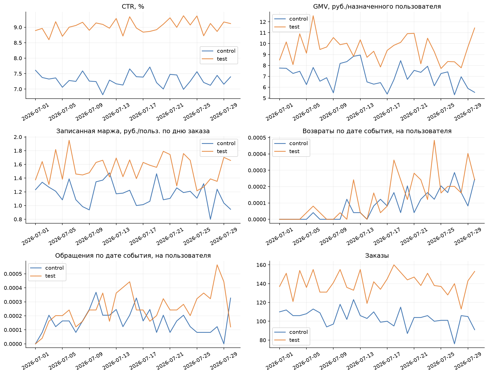
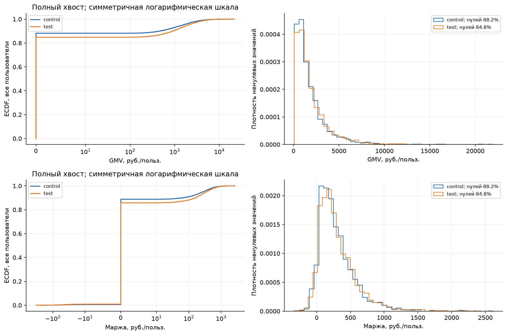
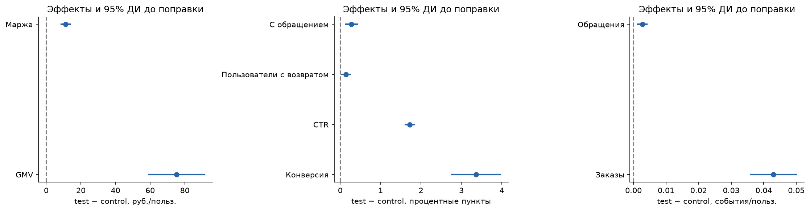
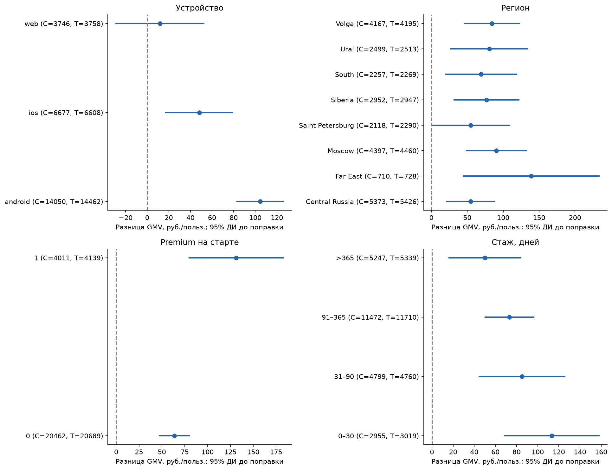
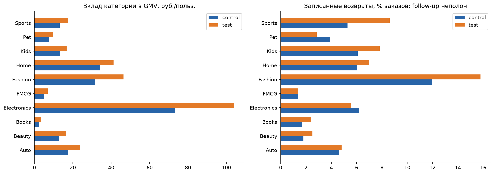
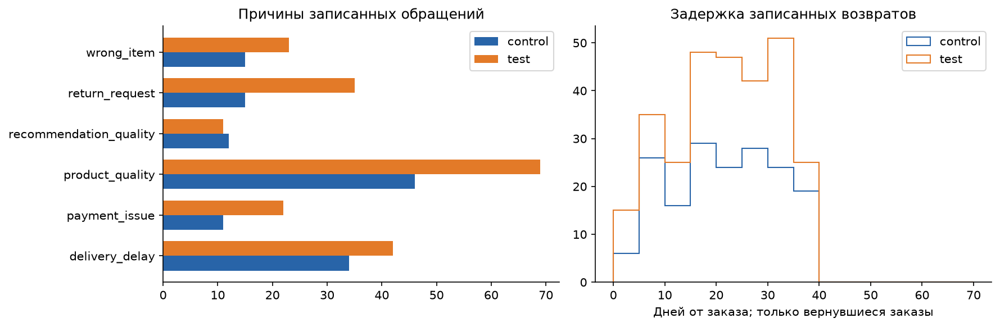
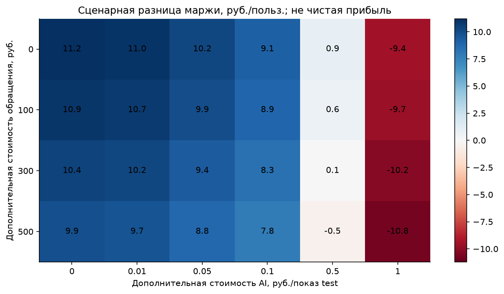

# Результат A/B-эксперимента AI-рекомендаций

Рост основной метрики подтверждается в выбранной выборке. Решение о запуске условно: необходимо проверить допустимый вред и неизвестные расходы.

Бизнес-пороги и расходы заданы не полностью; безусловное разрешение на запуск не формируется.

## Основные результаты

Основная выборка: control — 24,473, test — 24,828 пользователей.
GMV/user: control 211.15 руб., test 286.41 руб.; разница 75.27 руб.
(35.65%), 95% ДИ [59.15; 91.39], p после Holm = 2.339e-19.
Записанная маржа/user: разница 11.21 руб., 95% ДИ [8.63; 13.79].
Это валовая маржа с записанными возвратами, не чистая прибыль и не маржа на дату 30 июля.

| label | effect_display | ci_display | p_adjusted | method |
| --- | --- | --- | --- | --- |
| GMV на пользователя | 75.268 руб./польз. | [59.147; 91.389] | 2.339e-19 | Welch t-test |
| Записанная валовая маржа на пользователя | 11.209 руб./польз. | [8.626; 13.792] | 5.571e-17 | Welch t-test |
| Доля пользователей с обращением в эксперименте | 0.279 п.п. | [0.141; 0.420] п.п. | 0.0001641 | Two-proportion Z-test; Newcombe CI |
| Конверсия пользователя в покупку | 3.363 п.п. | [2.761; 3.966] п.п. | 3.248e-27 | Two-proportion Z-test; Newcombe CI |
| CTR уникальных записей показов | 1.719 п.п. | [1.612; 1.825] п.п. | 9.649e-217 | User-cluster delta method |
| Возвраты в эксперименте / заказы | 0.350 п.п. | [-0.328; 1.029] п.п. | 0.3888 | User-cluster delta method |
| Записанные возвраты / заказы | 1.289 п.п. | [0.182; 2.395] п.п. | 0.03744 | User-cluster delta method |
| Записанные обращения на заказ | 0.005 на пользователя | [-0.005; 0.015] | 0.3888 | User-cluster delta method |

Интервалы в таблице — индивидуальные, до поправки. Подтверждающее семейство Holm:
GMV/user, маржа/user, доли пользователей с возвратом и обращением внутри эксперимента.
Вторичные проверки имеют отдельную FDR-поправку. p-value не измеряет размер бизнес-выигрыша.

## Ограничения по вреду

- Доля пользователей с возвратом в эксперименте: эффект 0.145 п.п.; верхняя граница 0.248 п.п.; Порог не задан — безопасность не установлена.
- Доля пользователей с обращением в эксперименте: эффект 0.279 п.п.; верхняя граница 0.420 п.п.; Порог не задан — безопасность не установлена.

Верхние 97.5% границы для двух guardrail соответствуют односторонней поправке Bonferroni;
незначимое ухудшение само по себе не подтверждает безопасность.
Возвраты на заказ и обращения на заказ оцениваются с кластеризацией по пользователю.

## Данные и допущения

- Окно заказов и основного воздействия: 2026-07-01 — 2026-07-30, включительно.
- Рандомизация предполагается по user_id; ожидаемые группы 50%/50% — допущение.
- Исключены конфликты назначения и is_bot_candidate=1. Выборка после исключений не является полным ITT;
  фильтрация может влиять на причинную интерпретацию. Первичное назначение и включение ботов — чувствительность.
- Временная точность назначения — день. Для первичного назначения предполагается старт в начале дня;
  причинный ITT для конфликтующих пользователей требует подтверждения журнала рандомизации.
- Нули неактивных пользователей основаны на допущении о полноте журнала событий.
- Флаги дублей имеют самостоятельные ID и связанные клики: уникальные события сохранены;
  CTR без флага вынесен в чувствительность. Восстановимого оригинала по естественному ключу нет.
- Дата полной выгрузки: неизвестна. Последнее событие не доказывает полноту follow-up.
  Записанные поздние возвраты описательны; без даты выгрузки нет сопоставимого подтверждённого 30-дневного окна после каждого заказа.
- gross_margin_rub уже отражает возвраты; повторное вычитание возвратов не применяется.
- delivery_fee_rub не заполняется для основной метрики. Суммы доставки со сценарными заполнениями
  сохранены отдельно; экономический знак и включение доставки в маржу не установлены.
- Стоимость возвращённых заказов не объявляется суммой возмещения. Условный net GMV включается только отдельной настройкой.

## Сегменты и чувствительность

После FDR обнаружены взаимодействия: device/gmv_user, device/margin_user, device/support_user_window, is_premium/gmv_user, is_premium/margin_user
Сегменты исследовательские. Для ограниченного запуска нужны воспроизводимость эффекта,
допустимый вред и подтверждающий эксперимент в выбранном исходном сегменте.
Категории — вклад исходов на всей аудитории; покупатели категории не объявляются исходным сегментом.

Чувствительность: включение ботов, первичное назначение, CTR без помеченных показов,
верхняя отсечка GMV/маржи на общей 99-й перцентили. Усечённая метрика имеет другую гипотезу.
Bootstrap: 2000 повторений, seed 2026; KS: 1999 перестановок.
Для KS используются перестановки пользовательских меток из-за нулей и совпадений.
MDE — нормальное приближение чувствительности при мощности 80%; для редких событий
и небольших сегментов требует отдельного планирования. Наблюдаемая мощность не рассчитывается.

## Экономика и следующий шаг

Сценарий = записанная маржа − дополнительная стоимость записанных обращений
− стоимость AI-показов в test. Учитывается предположение, что эти расходы ещё не включены в маржу.
Расходы доставки, возвраты и подписная выручка повторно не добавляются.
Результат не включает все расходы бизнеса и поэтому не является чистой прибылью.

Предельная дополнительная цена AI-показа, при которой сценарная разница маржи
равна нулю (руб./показ test; интервалы дельта-метода):

| support_cost_rub | ai_break_even_rub_per_impression | ci_low | ci_high |
| --- | --- | --- | --- |
| 0 | 0.5435 | 0.4187 | 0.6682 |
| 100 | 0.5304 | 0.4063 | 0.6544 |
| 300 | 0.5042 | 0.3804 | 0.6279 |
| 500 | 0.478 | 0.3528 | 0.6031 |

При цене выше точечной границы ожидаемый сценарный выигрыш становится отрицательным;
нижняя граница интервала показывает более консервативный ориентир с учётом неопределённости.

Перед решением задать минимально полезный рост и допустимое ухудшение в п.п.,
подтвердить полноту последующего наблюдения, состав gross_margin_rub и стоимость AI/поддержки.
Для сегментного запуска повторить эксперимент в заранее выбранном сегменте.
Один синтетический эксперимент не доказывает долгосрочный эффект, удержание или LTV.

## Графики

Размеры групп показывают объём и асимметрию исключений; не доказывают баланс сами по себе.

Воронки показывают охват и этапы; событийные и пользовательские знаменатели различаются.

Дневные значения описательны; день остановки по ним не выбирается. Маржа привязана к заказу, но уже содержит записанные возвраты.

ECDF включает нули, гистограмма — ненулевые значения. Форма распределения не подменяет проверку среднего.

Линии — индивидуальные 95% ДИ; единицы разделены на панели, множественная поправка — в таблице.

Сегментные интервалы показывают точность; вывод о неоднородности требует теста взаимодействия и FDR.

GMV категорий нормирован на всю аудиторию. Записанная доля возвратов ограничена неизвестной полнотой наблюдения.

Причины и задержки описаны среди наблюдаемых событий; нулевая частота не доказывает отсутствие будущих обращений/возвратов.

Знак сценарной разницы меняется при неизвестных расходах; сетка значений не является согласованным бюджетом.

Все расчёты: [tables/](tables/). Настройки и хэши исходников: [run_metadata.json](run_metadata.json).
